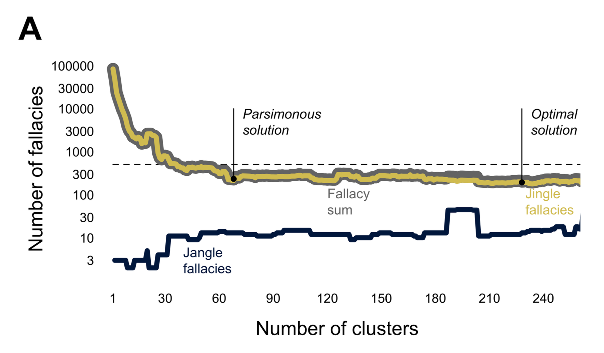
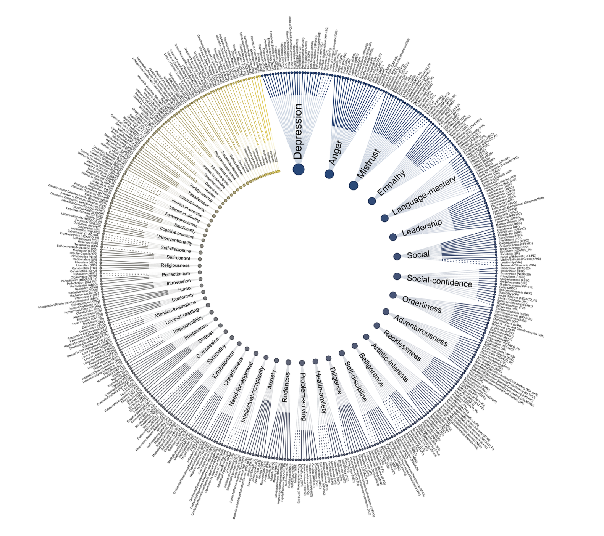
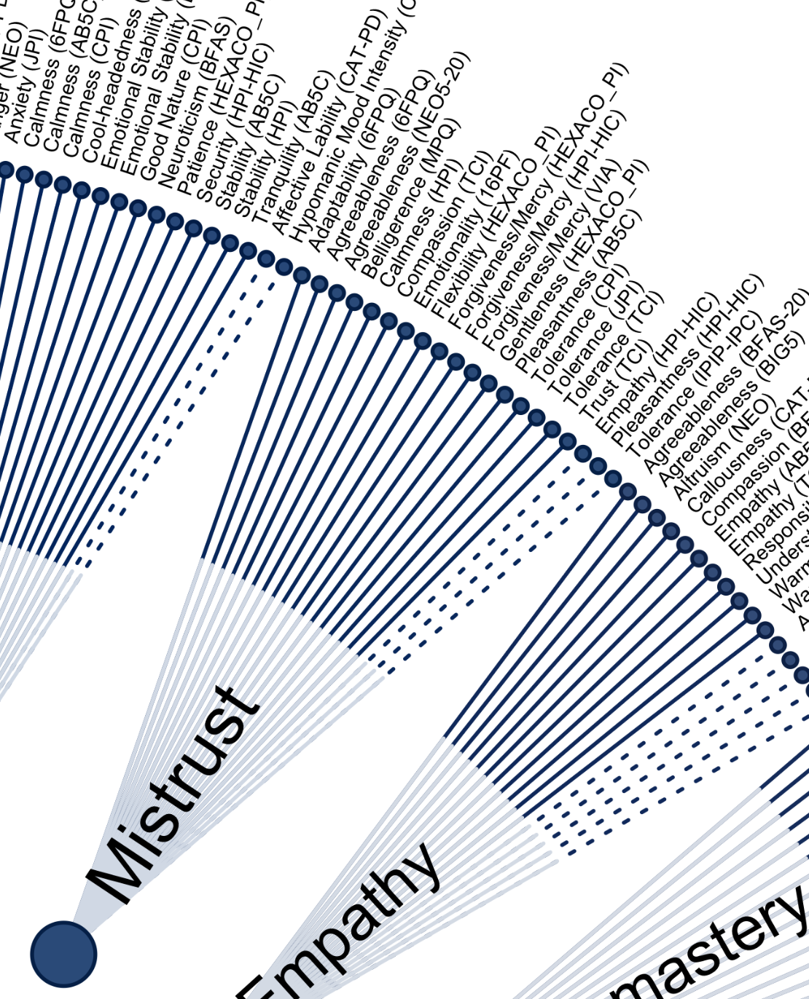
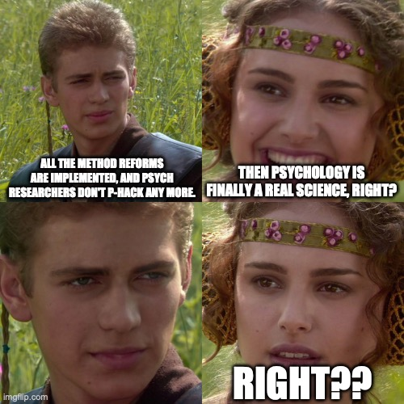

# Jinge Jangle Jungle {background-color="#40666e"}

## The Jingle-Jangle Problem

> "Almost a century ago, it was remarked by a Professor Aikins that the science of psychology frequently manifests what he called 'the [jingle]{.hl} fallacy,' a circumstance wherein two things that are quite different may be labeled equivalently, and thus the unwary may consider them interchangeable" (Block, 1995, p. 209)

::: {.fragment}
> The [jangle]{.hl} fallacy: "two separate words or expressions covering in fact the same basic situation, but sounding different, as though they were in truth different" (Kelley, 1927, p. 64)
:::

::: footer
Thorndike (1904); Kelley (1927); Block ([1995](https://doi.org/10.1037/0033-2909.117.2.187))
:::


## An Example for the Jingle Problem
### Autonomy

> " ... at least three views of autonomy appear to be present in the current autonomy literature [and] autonomy measures are not assessing the same construct" (Hmel & Pincus, 2002)

::: {.incremental}

- Autonomy$_1$: A cognitive vulnerability associated with depression
  - ["... lacks the essential agentic core that would be necessary for an autonomy construct. [...] it is inconsistent with conceptualizations of autonomy and in need of a label more consistent with its nature"]{.smaller}
- Autonomy$_2$: Self (*auto*) – governance (*nomous*)
- Autonomy$_3$: Emphasis on interpersonal separation
:::

[All three are labeled "autonomy" in the literature!]{.hl .fragment}

::: footer
Hmel & Pincus ([2002](https://doi.org/10.1111/1467-6494.05006))
:::


## An Example for the Jangle Problem
### Grit = ???

:::: {.columns}
::: {.column}
{fig-align="center" height="350px" .ds}
:::
::: {.column}
{fig-align="center" .ds}
:::
::::

::: {.fragment}
> "[Grit]{.hl} is not only an excellent predictor of success and performance but also the secret to success" - Duckworth et al. ([2007](https://doi.org/10.1037/0022-3514.92.6.1087))
:::

::: {.notes}
- "We define grit as perseverance and passion for long-term goals." ([Duckworth & Peterson, 2007](https://www.researchgate.net/profile/Angela-Duckworth/publication/6290064_Grit_Perseverance_and_Passion_for_Long-Term_Goals/links/56c3366c08ae602342507e84/Grit-Perseverance-and-Passion-for-Long-Term-Goals.pdf))
- Angela Duckworth's speaking fee range is $100,000 or more
:::


## An Example for the Jangle Problem
### Grit = Conscientiousness (Big 5 dimension)

::: {.incremental}
- "the best available evidence strongly suggests that grit is largely a repackaging of conscientiousness — a widely studied personality trait" (Credé, 2018)
- "Given the long history of research on conscientiousness and the better measures of it (compared to scales frequently used to measure grit) we believe that it would be better to ...
  - stop measuring grit with the Grit-S questionnaire
  - stop examining grit and rather continue to explore conscientiousness." (paraphrased from Ponnock et al., 2020)
:::

::: footer
Credé ([2018](https://doi.org/10.3102/0013189X18801322)); Ponnock et al. ([2020](https://doi.org/10.1016/j.jrp.2020.104021)); 
:::


## The Jingle-Jangle Problem

These jingle and jangle fallacies waste scientific time: 

- Jingle creates confusion and unncessary dispute ("No, the true meaning of autonomy is ...").
- Jangle involves useless redundancies, that lead to the ...
  - reinvention of constructs under new labels
  - decades of parallel literatures
  - (To what extent) are two theories actually the same theory? 
- &rarr; both slow down cumulative knowledge.

::: footer
paraphrased from Block ([1995](https://doi.org/10.1037/0033-2909.117.2.187))
:::


##  Group work (10 min.)

Collect candidates for the *jingle* and the *jangle* fallacy that you encountered during your studies.


::: {.callout-note title="Reminder"}
- Jingle = the same term for two (or more) distinct phenomena
- Jangle = different terms for the same underlying phenomenon
:::


## A modern approach to solve the jingle-jangle problem 
### ... using LLMs

- Analyzed 4452 items comprising 459 scales, capturing 277 constructs
- Automated jingle–jangle detection: Assessed the similarity of scales, 
  - jingle fallacy: high similarity in construct labels associated with low similarity in the associated scales (i.e., content)
  - jangle fallacy: low similarity in construct labels associated with high similarity in the associated scales (i.e., content).
- 504 fallacy candidates (340 jingle, 164 jangle)

::: footer
Wulff, D. U., & Mata, R. (2025). Semantic embeddings reveal and address taxonomic incommensurability in psychological measurement. Nature Human Behaviour, 9(5), 944–954. [https://doi.org/10.1038/s41562-024-02089-y](https://doi.org/10.1038/s41562-024-02089-y).
:::


## A modern approach to solve the jingle-jangle problem 

How many clusters are necessary to compress 459 scales (and how many jingle and jangle fallacies would we have)?

{fig-align="center"}

::: footer
Wulff, D. U., & Mata, R. ([2025](https://doi.org/10.1038/s41562-024-02089-y)). Picture from [https://osf.io/nmv29](https://osf.io/nmv29) under CC-BY.
:::


## A modern approach to solve the jingle-jangle problem 

Mapping 459 scales to 68 labels based on a parsimonious solution (compressing to 15%).

:::: {.columns}
::: {.column width='50%'}
{fig-align="center"}
:::

::: {.column width='50%'}
{fig-align="center"}
:::
::::


::: footer
Wulff, D. U., & Mata, R. ([2025](https://doi.org/10.1038/s41562-024-02089-y)). Picture from [https://osf.io/nmv29](https://osf.io/nmv29) under CC-BY.
:::


# Data, phenomena,<br>and the replication crisis {background-color="#40666e"}

## The relation of theory, phenomena, and data

::: {.svg-w800 style="text-align: center;"}
```{mermaid}
%%| fig-width: 18
%%{ init: { 'flowchart': { 'curve': 'natural' } } }%%
flowchart LR
  T(Theory)
  P(Phenomena)
  D(Data)
  
  T -- "Explanation" --> P
  P -- "Abduction" --> T
  P -- "Prediction" --> D
  D -- "Generalization" --> P
```
:::

(We will discuss this model in detail in the next session)

::: footer
See Borsboom et al. (2021). Theory Construction Methodology: A Practical Framework for Building Theories in Psychology. Perspectives on Psychological Science, 16(4), 756–766. [https://doi.org/10.1177/1745691620969647](https://doi.org/10.1177/1745691620969647)
:::


## The relation of data and phenomena
::: {.svg-h100 style="text-align: center;"}
```{mermaid}
%%| fig-width: 6
%%{ init: { 'flowchart': { 'curve': 'natural' } } }%%
flowchart LR
  P(Phenomena)
  D(Data)
  
  P -- "Prediction" --> D
  D -- "Generalization" --> P
```
:::

**Phenomena**: Stable and general features of the world in need of explanation. Can be understood as robust generalizations of patterns in empirical data. They are the explanatory targets for scientific theories. In psychology often called "effects".

**Data**: Relatively direct observations. Refer to *particular* empirical patterns in concrete data sets rather than empirical generalizations (which would be phenomenona). Also called a "finding".

::: footer
See Borsboom et al. (2021). Theory Construction Methodology: A Practical Framework for Building Theories in Psychology. Perspectives on Psychological Science, 16(4), 756–766. [https://doi.org/10.1177/1745691620969647](https://doi.org/10.1177/1745691620969647)
:::


## The relation of data and phenomena
### Generalization
::: {.svg-h100 style="text-align: center;"}
```{mermaid}
%%| fig-width: 6
%%{ init: { 'flowchart': { 'curve': 'natural' } } }%%
flowchart LR
  P(Phenomena)
  D(Data)
  
  P -- "Prediction" --> D
  D -- "Generalization" --> P
  
  linkStyle 1 stroke-width:2px,stroke:red,color:red;
```
:::

::: {.smaller}
Data provide evidence for the existence of empirical phenomena: You <span style="color:red;">generalize</span> from one or more data sets with strong evidence to a general phenomenon.

Generalize to *what*? UTOS framework:

- [U]{.hl}nits (i.e., sample characteristics): To which other types of tested units does it generalize?
- [T]{.hl}reatments: Does it generalize to other operationalizations of the independent variable/treatment?
- [O]{.hl}utcomes: Does it generalize to other operationalizations of the dependent variable/outcome?
- [S]{.hl}ettings: Does it generalize to other settings, e.g. lab vs. field, other countries?
:::

::: footer
UTOS framework from Cronbach & Shapiro (1982); for an update to "M-STOUT", including *mechanims* and *time*, see [Findley et al. (2021)](https://doi.org/10.1146/annurev-polisci-041719-102556).
:::


## The relation of data and phenomena
### Generalization
::: {.svg-h100 style="text-align: center;"}
```{mermaid}
%%| fig-width: 6
%%{ init: { 'flowchart': { 'curve': 'natural' } } }%%
flowchart LR
  P(Phenomena)
  D(Data)
  
  P -- "Prediction" --> D
  D -- "Generalization" --> P
  
  linkStyle 1 stroke-width:2px,stroke:red,color:red;
```
:::

::: {.smaller}
To claim a (robust) phenomenon, you ideally need:

- Independent replications with the *same* operationalizations (U, maybe S is varied): Often called "direct", "exact", or "close" replications
- Replications with *different* operationalizations (UTOS is varied): Often called "conceptual" replications
:::


## The relation of data and phenomena

::: {.svg-h100 style="text-align: center;"}
```{mermaid}
%%| fig-width: 6
%%{ init: { 'flowchart': { 'curve': 'natural' } } }%%
flowchart LR
  P(Phenomena)
  D(Data)
  
  P -- "Prediction" --> D
  D -- "Generalization" --> P
  
  linkStyle 1 stroke-width:2px,stroke:red,color:red;
```
:::

Probably most of psychological research is about *establishing phenomena* (disguised as "theories").

Techniques used to detect data patterns:

- Factor analysis
- Principal components analysis
- Regression
- ANOVA
- ...

::: footer
See [presentation](https://video.uu.nl/videos/helmholtz-lecture-2023-02-10-prof-denny-borsboom/#timeline) of Denny Borsboom
:::


## The relation of data and phenomena
### Prediction

::: {.svg-h100 style="text-align: center;"}
```{mermaid}
%%| fig-width: 6
%%{ init: { 'flowchart': { 'curve': 'natural' } } }%%
flowchart LR
  P(Phenomena)
  D(Data)
  
  P -- "Prediction" --> D
  D -- "Generalization" --> P
  
  linkStyle 0 stroke-width:2px,stroke:red,color:red;
```
:::

Phenomena (once their existence has been established) [predict]{style="color:red"} similar data patterns in new data sets of the *same* operationalization (as in "direct replication") and ideally also for *new* operationalizations (as in "conceptual replication", changing more UTOS dimensions).

## Interlude: The risky shift phenomenon 1

::: {.r-fit-text}
**The risky shift phenomenon**: A group's decisions are riskier than the average of the individual decisions of members before the group met (i.e., the group discussion made individuals riskier).

::: {.incremental}
- Area of very active research in social psychology in the 1960s.
- "It could be easily replicated. Most of the replication studies [...] employed the CDQ [Choice Dilemma Questionnaire] as their stimulus set, and they generally had no trouble obtaining the basic risky shift result."
- **Today we know that there is no risky shift.** "It is now clear that the items contained in the original CDQ are in no sense a representative sample of the universe of all possible items. Instruments similar to the CDQ could readily be constructed whose scores would display risky shifts, cautious ones, or none at all" (Cartwright, 1971, p. 368).
- In the early risky shift literature, theoretical progress was unnecessarily impeded by multiple generations of replication studies (*k* ⋍ 200), nearly all relying on the same CQD questionnaire.
:::
:::

::: footer
See Westfall et al. (2015). Replicating Studies in Which Samples of Participants Respond to Samples of Stimuli. Perspectives on Psychological Science, 10(3), 390–399. https://doi.org/10.1177/1745691614564879
:::

## Interlude: The risky shift phenomenon 2

** Questions for discussion (10 min.):**

- Analyse the situation in the UTOS dimensions (units, treatments, outcomes, settings): To which dimensions did the successful replications (not) refer to?
- Is the "risky shift" effect - as demonstrated in the early publications - a *phenomenon*?

. . . 

::: {.callout-note}
*My take*: It *is* a phenomenon (though a weak one), as it generalizes to new units (i.e., new participants) of the same operationalization. But the generalizability was much weaker than initially expected. It is a phenomenon of this specific stimulus set (*outcome operationalization*) and suggests certain types of research questions (e.g., "What is so specific to this stimulus set?").
:::


## Replication crisis
### Focus on phenomena

::: {.svg-h100 style="text-align: center;"}
```{mermaid}
%%{ init: { 'flowchart': { 'curve': 'natural' } } }%%
flowchart LR
  P(Phenomena)
  D(Data)
  
  P -- "Prediction" --> D
  D -- "Generalization" --> P
```
:::

The concerns of the replication crisis typically referred to the relation between *data* and *phenomena*:

- Does an empirical pattern even *exist*? (Or is it a false positive?)
- If we found a reproducible pattern with a specific operationalization: Is it *generalizable* (to other measures, other cultural contexts, other samples)?
- [Do we even have a phenomenon in a particular research line?]{.hl} And how strongly should we belief in the existence of a phenomenon, given the empirical evidence?

## Replication crisis
### Focus on phenomena
::: {.svg-h100 style="text-align: center;"}
```{mermaid}
%%| fig-width: 6
%%{ init: { 'flowchart': { 'curve': 'natural' } } }%%
flowchart LR
  T(Theory)
  P(?? Phenomena ??)
  D(Data)
  
  T -- "Explanation" --> P
  P -- "Abduction" --> T
  P -- "??" --> D
  D -. "?? Generalization ??" .-> P
  
  linkStyle 2 stroke-width:0px,stroke:grey,color:grey;
  linkStyle 3 stroke-width:2px,stroke:red,color:red;
```
:::

- Doubts about phenomena propagate to theories: If there is no phenomenon to explain, any explanatory theory gets obsolete.
- Doubts about phenomena propagate to data: If there is no generalizable pattern, we cannot predict new data.

# From replication crisis to theory crisis {background-color="#40666e"}

## Reimagining psychology as a science

{fig-align="center" .ds}

## "Addressing the theory crisis in psychology"

::: {.svg-h100 style="text-align: center;"}
```{mermaid}
%%| fig-width: 18
%%{ init: { 'flowchart': { 'curve': 'natural' } } }%%
flowchart LR
  T(Theory)
  P(Phenomena)
  D(Data)
  
  T -- "Explanation" --> P
  P -- "Abduction" --> T
  P -- "Prediction" --> D
  D -- "Generalization" --> P
```
:::


> "We argue that a further cause of poor replicability is the often weak logical link between theories and their empirical tests. [...] A strong link between theories and hypotheses is best achieved by formalizing theories as computational models."
>
> "Many of these proposals [i.e., method reforms] are helpful ideas for raising the standards of good research practice, primarily ensuring more trustworthy inferences on the empirical level of scientific inference — the level connecting observations to empirical generalizations. Our concern is that shoring up the strength of inferences on the empirical level does not by itself address deficits on the theory level — the level connecting empirical generalizations to theories."
> <div style="text-align: right; font-size: 70%">*Oberauer & Lewandowsky (2019)*</div>


::: footer
Oberauer, K., & Lewandowsky, S. (2019). Addressing the theory crisis in psychology. *Psychonomic Bulletin & Review*, 26(5), 1596–1618. [https://doi.org/10.3758/s13423-019-01645-2](https://doi.org/10.3758/s13423-019-01645-2)
:::


# Summary and Outlook

## Summary: Challenges to building useful theories in psychology

::: {.incremental}
- **Problems of theoretical precision** of psychological constructs (jingle-jangle)
- Relative **lack of robust phenomena** that impose constraints on possible theories
- These two lead to problems of **validity of psychological constructs** (i.e., do they actually related to the real world?)
- **Obstacles to discovering causal relationships** between psychological variables
- The probably **most complex research object** in the known universe is investigated with...
  - ... ridiculously small samples,
  - ... shaky research methods, and
  - ... imprecise theories.
:::

::: footer
See Eronen & Bringmann (2021); Slide adapted from [Karolin Salmen](https://www.psycharchives.org/en/item/cde1ef17-611c-42d0-8835-95592cab521a), CC-BY
:::


## Outlook: How we will try to make it better ...

- Learn to use the Visual Argument Structure Tool (VAST)
  - Clear labels, that denote a precise latent construct.
  - A consensus about the meaning of words helps to communicate within and beyond the scientific community.
  - Conceptual precision increases its ability to be criticized.
- Learn how to formalize verbal theories
  - Mathematical models
  - (not covered in this course: Agent-based models)
- Simulate the models: Are they able to produce the phenomena we observe in the data?
- Practice with your own theory


<!-- Footer insert below -->
```{r child="../../common/lastslide.qmd"}
```
