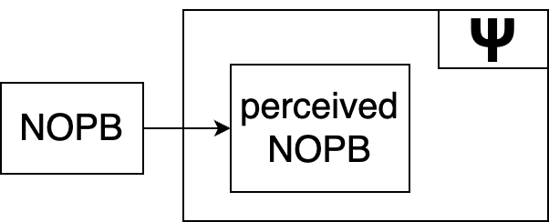
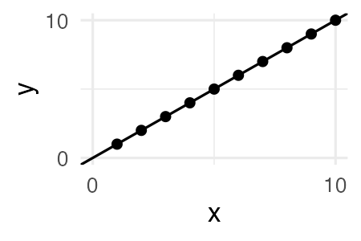
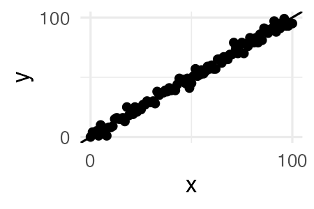
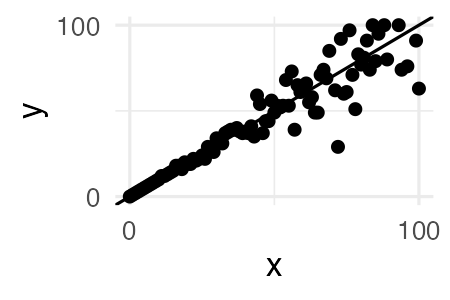

```{r setup, include=FALSE}
# Global chunk options
knitr::opts_chunk$set(
  fig.align = "center",   # Center-align figures
  echo = FALSE,           # Do not display code by default
  fig.width = 10,          # Default figure width
  fig.height = 5          # Default figure height
)
set_par <- function() {
  par(cex = 2, cex.main=1.2,  mar = c(4, 4, 1.7, 1))  # Bottom, left, top, right margins
}
library(ggplot2)
```

## Sensors
### Entering the psyche: From manifest/objective features to subjective representations

{height="150px" fig-align="center"}

Think about the capabilities of our sensors. E.g. we can quite well differentiate the distance to another person within 10m. But between 500 and 800m - how precise could you distinguish that?


## Sensors

```{r}
p1 <- ggplot(
  tibble::tibble(x = 1:10, y = 1:10),
  aes(x=x, y=y)
  ) +
    geom_point() +
  geom_abline(intercept=0, slope=1) +
  scale_x_continuous(breaks = c(0, 10), limits = c(0, 10)) +
  scale_y_continuous(breaks = c(0, 10), limits = c(0, 10)) +
  theme_minimal(base_size = 16)

ggsave("img/Toolbox-p1.png", p1, width = 3, height = 2, dpi = 150)

p2 <- ggplot(
  tibble::tibble(
    x = seq(0, 100),
    y = x + rnorm(length(x), 0, 3) |> round()
  ),
  aes(x=x, y=y)
  ) +
    geom_point() +
  geom_abline(intercept=0, slope=1) +
  scale_x_continuous(breaks = c(0, 100), limits = c(0, 100)) +
  scale_y_continuous(breaks = c(0, 100), limits = c(0, 100)) +
  theme_minimal(base_size = 16)

ggsave("img/Toolbox-p2.png", p2, width = 3, height = 2, dpi = 150)


set.seed(123)
p3 <- ggplot(
  tibble::tibble(
    x = seq(0, 100),
    y = x + rnorm(length(x), 0, (x*.06)^2) |> round()
  ),
  aes(x=x, y=y)
  ) +
    geom_point() +
  geom_abline(intercept=0, slope=1) +
  scale_x_continuous(breaks = c(0, 100), limits = c(0, 100)) +
  scale_y_continuous(breaks = c(0, 100), limits = c(0, 100)) +
  theme_minimal(base_size = 16)

ggsave("img/Toolbox-p3.png", p3, width = 3, height = 2, dpi = 150)
```


| Type                  | Assumption                                       | Formula                                              | -                                  |
| --------------------- | ------------------------------------------------ | ---------------------------------------------------- | ---------------------------------- |
| Identity function     | Organisms perfectly perceive the manifest signal | $\text{y} = \text{x}$                                | {width=180} |
| + constant noise      | The sensor is noisy                              | $\text{y} = \text{x} + e$<br>$e \sim N(0, \sigma^2)$ | {width=180} |
| + heterogeneous noise | The sensor is noisy for large quantities only    | $\text{y} = \text{x} + e$<br>$e \sim N(0, (\sigma x)^2)$ | {width=180} |


<!-- Footer insert below -->
```{r child="../../common/lastslide.qmd"}
```
